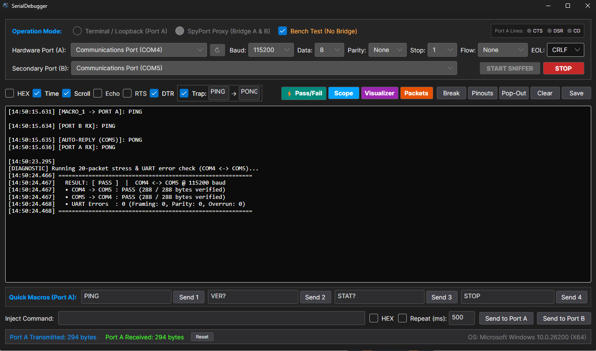
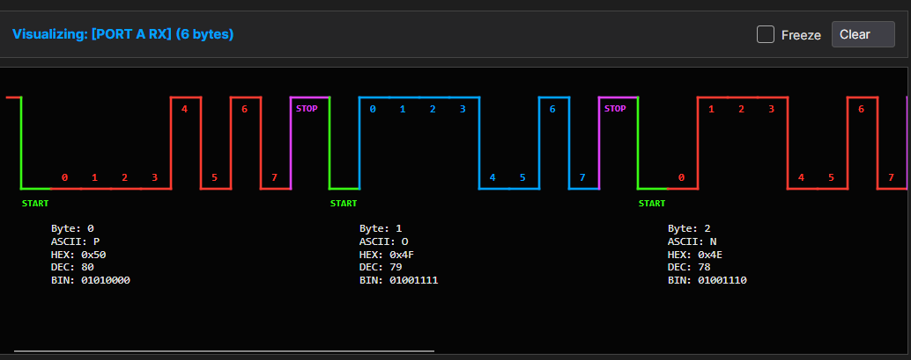
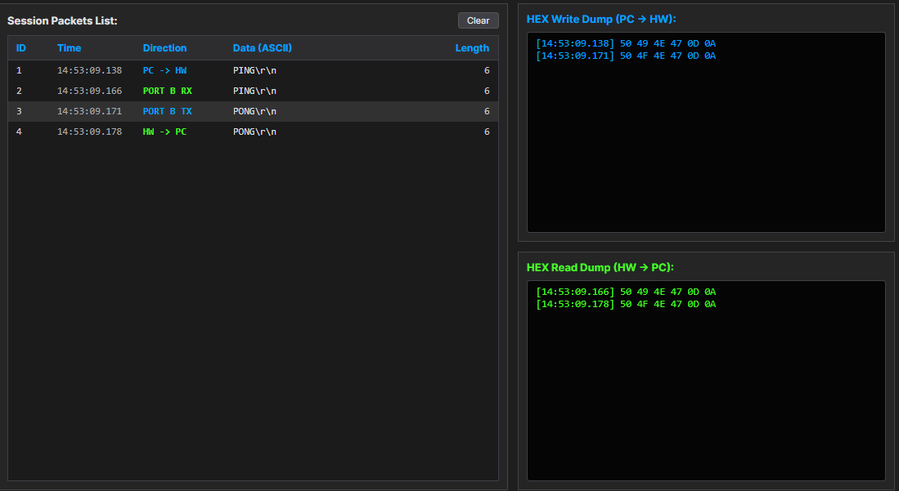
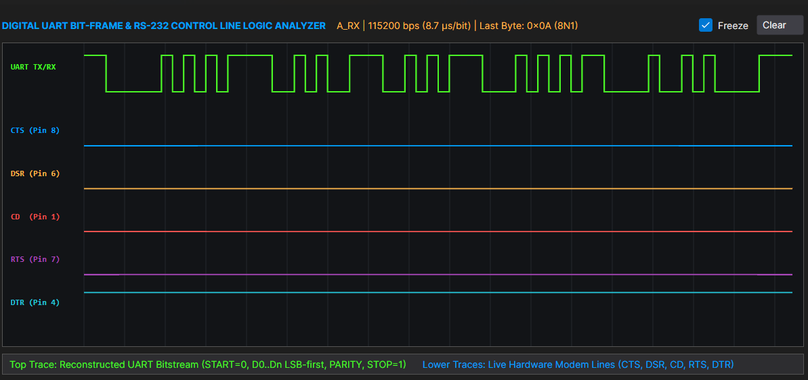

# SerialDebugger

**Cross-platform industrial serial port debugger, protocol analyzer & bench-testing suite**

Built with **.NET 9** + **Avalonia UI** · Runs natively on **Windows · Linux · macOS**  
Single codebase · Self-contained single-file executables · No runtime required on target machines

---

<p align="center">
  
</p>

<p align="center">
  <em>Bench Test mode · dual-port stress test · auto-reply traps · live line status · one-click Pass/Fail</em>
</p>

---

## Why SerialDebugger?

Most serial tools are either terminal emulators or expensive logic analyzers.  
SerialDebugger sits in the middle: a **real bench instrument** that lets you talk to hardware, spy on traffic, inject macros, and prove a link is solid — all from one dark, focused UI.

Perfect for:

- Embedded developers debugging UART / RS-232 / RS-485
- Industrial controls (Watlow, PLC, HMI, custom boards)
- Hardware bring-up and loopback validation
- Multi-monitor bench setups

---

## Operation Modes

| Mode | What it does |
|------|--------------|
| **Terminal / Loopback (Port A)** | Classic single-port terminal + hardware loopback testing |
| **SpyPort Proxy (Bridge A ↔ B)** | Transparent man-in-the-middle sniffer between two ports |
| **Bench Test (No Bridge)** | Independent dual-port testing with isolated TX/RX tracking and per-port auto-reply rules |

---

## Floating Diagnostic Suite

### Byte Visualizer
Renders every UART frame as a color-coded square waveform:

- Neon green **START** bit
- Alternating red / blue data bits **0–7** (LSB-first)
- Magenta **STOP** bit

Aligned ASCII · HEX · DEC · BIN readout under each byte.

<p align="center">
  
</p>

### Packet Monitor
Timestamped packet table + dedicated live HEX dumps:

- `ID · Time · Direction · Data (ASCII) · Length`
- **HEX Write Dump** (PC → HW)
- **HEX Read Dump** (HW → PC)

<p align="center">
  
</p>

### Logic Scope
Real-time reconstructed UART bitstream + live RS-232 control lines (CTS, DSR, CD, RTS, DTR).

<p align="center">
  
</p>

### Also included
- **DB9 Wiring & Pinout Guide** — null-modem, loopback plug, RS-422 full-duplex, RS-485 half-duplex
- **Pop-Out Traffic Monitor** — detachable live console for multi-monitor benches

---

## Hardware Control & Automation

- **1-Click Pass/Fail Diagnostic**  
  20-packet stress sequence (incremental ASCII + `0x55` / `0xAA` / `0x00` / `0xFF` patterns) with framing / parity / overrun monitoring

- **Line Control**  
  Manual **RTS** / **DTR** toggles · **250 ms BREAK** pulse · live **CTS / DSR / CD** LEDs

- **Traffic Injection & Macros**  
  ASCII or HEX payloads · selectable EOL (`CRLF` / `CR` / `LF` / `None`) · cyclic auto-repeat · 4 quick macros · **Trap** auto-reply (`PING → PONG`)

- **Session Logging**  
  Timestamped view · HEX/ASCII toggle · auto-scroll · byte counters · `.txt` export

---

## Getting Started

### Prerequisites
[.NET 9.0 SDK (x64)](https://dotnet.microsoft.com/download/dotnet/9.0)

### Run from source
```bash
dotnet run --project SerialDebugger
```

---

## Build Standalone Cross-Platform Binaries

Self-contained single-file executables (no .NET runtime needed on the target machine):

```powershell
# Windows (x64)
dotnet publish SerialDebugger -c Release -r win-x64 --self-contained true -p:PublishSingleFile=true

# Linux (x64)
dotnet publish SerialDebugger -c Release -r linux-x64 --self-contained true -p:PublishSingleFile=true

# macOS (Apple Silicon)
dotnet publish SerialDebugger -c Release -r osx-arm64 --self-contained true -p:PublishSingleFile=true

# macOS (Intel)
dotnet publish SerialDebugger -c Release -r osx-x64 --self-contained true -p:PublishSingleFile=true
```

Output lands in:  
`SerialDebugger/bin/Release/net9.0/<runtime-id>/publish/`

### First-run notes

**Linux**
```bash
chmod +x ./SerialDebugger
sudo usermod -aG dialout $USER   # serial port access
./SerialDebugger
```

**macOS**
```bash
chmod +x ./SerialDebugger
xattr -d com.apple.quarantine ./SerialDebugger   # if copied from USB
./SerialDebugger
```

---

## Project Layout

```text
SerialDebugger/
├── SerialDebugger.sln
├── .gitignore
├── .vscode/
│   ├── launch.json
│   ├── settings.json
│   └── tasks.json
└── SerialDebugger/
    ├── Assets/
    │   └── SpyPortDebugger.ico
    ├── App.axaml / App.axaml.cs
    ├── MainWindow.axaml / MainWindow.axaml.cs
    ├── ByteVisualizerWindow.axaml / ByteVisualizerWindow.axaml.cs
    ├── PacketMonitorWindow.axaml / PacketMonitorWindow.axaml.cs
    ├── ScopeWindow.axaml / ScopeWindow.axaml.cs
    ├── Program.cs
    └── SerialDebugger.csproj
```

---

## License & Credits

Built for the bench. Designed to stay out of the way until you need it.  
If it saved you time on a hard-to-reach RS-485 link or an ESP32 bring-up, star the repo.

---

<p align="center">
  <strong>SerialDebugger</strong> · .NET 9 · Avalonia UI · Windows / Linux / macOS
</p>
